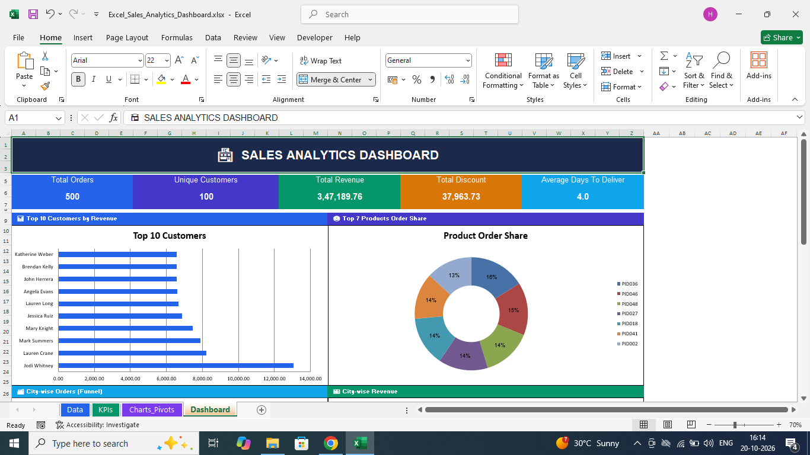
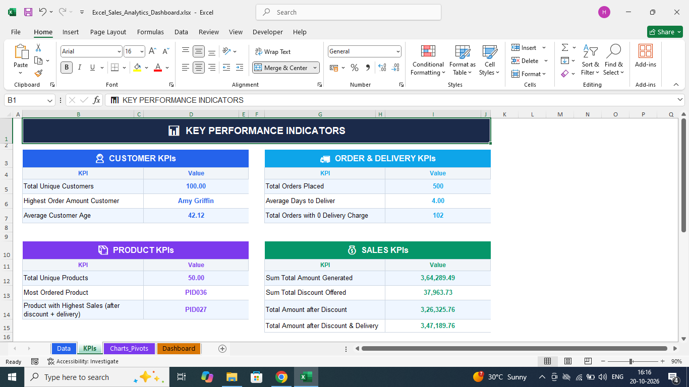

# Excel Sales Analytics Dashboard

An Excel-based data analytics project developed as part of a guided mini-project. The objective is to analyse customer behaviour, sales performance, discounts and delivery efficiency using Microsoft Excel.

## Project Overview

This project transforms order-level data into useful business metrics and visualisations. It includes calculated fields, KPI summaries, supporting chart data and a consolidated sales dashboard.

## Objectives

- Analyse customer and order information.
- Calculate customer, product, sales and delivery KPIs.
- Evaluate discount coupons and delivery charges.
- Compare sales performance across cities, products, customers and months.
- Present findings through charts and a dashboard.

## Tools and Techniques

- **Tool:** Microsoft Excel
- **Formulas:** IF, COUNTIF, AVERAGE, SUM, INDEX, MATCH and other relevant functions
- **Data preparation:** Calculated columns, date calculations, discount calculations and customer-name concatenation
- **Visualisation:** Bar charts, donut charts, pie charts, funnel charts and clustered bar charts
- **Analysis:** KPI reporting and sales performance analysis

## Key Calculations

The workbook includes calculated fields for:

- Full customer name
- Order amount based on price and quantity
- Discount percentage based on coupon code
- Discounted amount
- Amount including applicable delivery charges
- Days taken to deliver
- Delivery status based on estimated and actual delivery timing

## Dashboard and Analysis

The project explores the following questions:

1. Who are the highest-value customers?
2. Which products receive the most orders?
3. How do sales vary across cities?
4. Which discount coupons are used most frequently?
5. How do monthly sales differ by gender?
6. How efficiently are orders delivered?

## Project Structure

- `Excel_Sales_Analytics_Dashboard.xlsx` — completed Excel analysis and dashboard
- `screenshots/` — dashboard and visualisation previews
- `docs/project-requirements.md` — project requirements

## Results

The workbook includes KPI summaries for customer, order, delivery, product and sales performance. Visualisations support comparisons across customers, products, locations, coupon usage and order months.

See the dashboard screenshots and workbook for the detailed results.

## Dashboard Preview

## KPI Summary

## Data Privacy

The original dataset is not included in this repository.

## Learning Outcomes

- Applying Excel formulas to business data
- Calculating sales and delivery KPIs
- Analysing discount and coupon performance
- Creating charts and dashboard layouts
- Communicating data-driven findings

## Acknowledgement

This project was completed as part of an instructor-guided Excel mini-project.

---

*Project focus: Excel analytics, sales reporting and business intelligence.*
